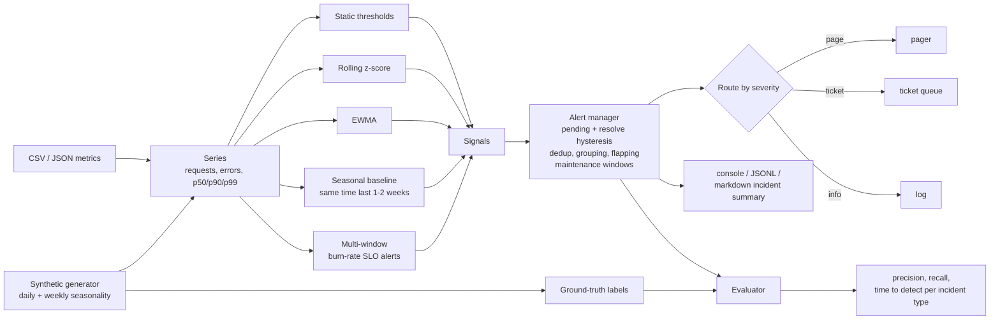

# slo-anomaly-alerts

An observability toolkit that catches the problems static threshold alarms miss.
It is pure Python 3.12 with no runtime dependencies.

## The problem

A typical alarm says "page me when the error rate is above 5%". That alarm is blind to many real outages:

- **Traffic drops.** A broken DNS record or a bad client release can cut requests by 45%. The requests that still arrive succeed, so availability stays at 100%. No error alarm fires, and the floor alarm ("requests < 100") is far below normal traffic.
- **Latency regressions.** p99 goes from 250 ms to 1 s. The static p99 alarm is set at 1.5 s so that short blips do not page anyone.
- **Slow burns.** The error rate climbs from 0.02% to 1.2% over 16 hours. It never crosses 5%, but it spends a large part of the monthly error budget.

At the same time, static alarms page on 3-minute blips that fix themselves.

This project builds the detectors that close those gaps. It also builds an alert manager that keeps them quiet, a synthetic data set with labeled incidents, and an evaluation that measures which detector catches what.

## How it works



| Module | What it does |
|---|---|
| `series.py` | Loads CSV, JSON, or JSON Lines. Columns: `ts`, `requests`, `errors`, `p50_ms`, `p90_ms`, `p99_ms`. Timestamps are epoch seconds or ISO 8601. |
| `detectors.py` | Static thresholds, rolling z-score, EWMA, and a seasonal baseline with a band. |
| `burnrate.py` | Multi-window, multi-burn-rate alerts (Google SRE Workbook) for availability and latency SLOs. |
| `alerts.py` | Alert manager: pending period, resolve hysteresis, dedup, grouping, flapping suppression, maintenance windows, severity routing. |
| `output.py` | Console and JSONL sinks and the markdown incident summary. |
| `synth.py` | Deterministic generator with seasonality, injected incidents, benign noise, and labels. |
| `evaluate.py` | Precision, recall, and time to detect per detector and per incident type. |

### Detectors

- **Static threshold.** `error_rate > 5%`, `p99 > 1500 ms`, `requests < 100`. This is the baseline to beat.
- **Rolling z-score.** It compares each point with the mean and standard deviation of the previous 60 minutes and fires at |z| > 4. A `min_delta` floor stops tiny absolute moves on near-zero metrics, for example one extra error.
- **EWMA.** This detector uses an exponentially weighted mean and variance (alpha 0.05) and fires at 4 sigma. Anomalous points do not update the baseline for up to 30 steps. Without that freeze, the first outlier inflates the variance and hides the rest of the shift. On this data set, EWMA without the freeze has 0% recall.
- **Seasonal baseline.** It compares a 5-minute median with the same minute in the last 1 or 2 weeks, with a ±30% band. With 2 weeks, the band is the envelope of both weeks. Thus a bad week cannot cause an "echo" alert at the same time the next week.
- **Burn rate.** The burn rate is the bad-event ratio divided by the error budget. A burn rate of 1 spends exactly the budget in the SLO period (30 days). An alert fires when a long window *and* a short window both burn faster than the threshold:

  | Long window | Short window | Burn rate | Budget spent in the long window | Severity |
  |---|---|---|---|---|
  | 1h | 5m | 14.4x | 2% | page |
  | 6h | 30m | 6x | 5% | page |
  | 1d | 2h | 3x | 10% | ticket |
  | 3d | 6h | 1x | 10% | ticket |

  The long window proves that the problem is big. The short window proves that it is still happening, so the alert resolves within minutes of recovery. The availability SLO is 99.9% of requests without errors. The latency SLO is 99% of requests under 400 ms. The share of slow requests is estimated from p50, p90, and p99 (see Limitations).

### Alert manager

| Feature | Behavior |
|---|---|
| Pending period (`pending_s=120`) | The signal must hold for 3 consecutive minutes before an alert opens. A gap restarts the clock. |
| Resolve hysteresis (`resolve_s=900`) | The alert stays open until the signal is quiet for 15 minutes. This stops open/close churn at the edge of a band. |
| Dedup | One alert per (service, detector, metric). Repeated and duplicate signals update that alert and do not send a new notification. |
| Grouping (`group_by=("service",)`) | Alerts that open while a group is active join it. The first alert sends `open`. Later alerts send `update` to the log, not to the pager. |
| Escalation | When the group's highest severity rises (ticket to page), one `escalate` notification goes to the new route. |
| Flapping | When an alert opens 3 times in 1 hour, it is marked flapping. One `flapping` notice goes to the log, and its opens and resolves are held. |
| Maintenance windows | Notifications in a window are recorded with `suppressed: maintenance` and are not delivered. If the problem is still active when the window ends, the `open` is delivered then. |
| Routing | `page -> pager`, `ticket -> ticket`, `info -> log`. You can change the map. |

## Quickstart

```bash
python3.12 -m venv .venv && source .venv/bin/activate
pip install -e '.[dev]'

python -m sloalerts eval          # generate 4 weeks of data (seed 42) and compare all detectors
pytest                            # 54 tests

python -m sloalerts generate --out data            # data/metrics.csv + data/labels.json
python -m sloalerts eval --metrics data/metrics.csv --labels data/labels.json
python -m sloalerts detect --metrics data/metrics.csv --service checkout-api \
    --maintenance 2026-01-20T00:00:00Z,2026-01-21T00:00:00Z \
    --jsonl data/notifications.jsonl --summary data/incident-summary.md
```

`detect` uses `seasonal_2w,burn_rate` by default. Use `--detectors all` or a comma list to change it. [`examples/incident-summary.md`](examples/incident-summary.md) shows the markdown output for the seed-42 data.

## Evaluation

The data is 4 weeks of 1-minute metrics for one service, with seed 42. The first week is a clean warm-up so that the seasonal baseline has history. Weeks 2 to 4 contain 12 labeled incidents, 3 of each type:

| Incident | Injected change |
|---|---|
| `traffic_drop` | Requests fall 45% for 60 minutes. Errors do not rise, so availability stays at ~100%. |
| `error_spike` | The error rate is 8% for 15 minutes. |
| `latency_regression` | p50 x2.5, p90 x4.5, p99 x4 for 90 minutes. |
| `slow_burn` | The error rate ramps from 0.02% to 1.2% over 16 hours. |

There are also 23 unlabeled noise events: 10 error blips (6% for 3 minutes), 10 latency blips (p99 x8 for 2 minutes), and 3 traffic surges (+35% for 40 minutes). An alert is a true positive if it opens between the incident start and 1 hour after the incident end. All detectors go through the same alert-manager policy.

Output of `python -m sloalerts eval`:

| Incident type | static | zscore | ewma | seasonal_1w | seasonal_2w | burn_rate | seasonal_2w+burn_rate |
|---|---|---|---|---|---|---|---|
| traffic_drop (n=3) | 0/3 | 3/3 in 2m | 3/3 in 2m | 3/3 in 4m | 3/3 in 4m | 0/3 | 3/3 in 4m |
| error_spike (n=3) | 3/3 in 2m | 3/3 in 2m | 3/3 in 2m | 3/3 in 4m | 3/3 in 4m | 3/3 in 13m | 3/3 in 4m |
| latency_regression (n=3) | 0/3 | 3/3 in 2m | 3/3 in 2m | 3/3 in 4m | 3/3 in 4m | 1/3 in 57m | 3/3 in 4m |
| slow_burn (n=3) | 0/3 | 0/3 | 0/3 | 3/3 in 5.1h | 3/3 in 5.1h | 3/3 in 10.2h | 3/3 in 5.1h |
| **Recall** | 25% | 75% | 75% | 100% | 100% | 58% | 100% |
| **Precision** | 25% | 52% | 41% | 54% | 58% | 70% | 61% |
| **False alerts / week** | 2.2 | 2.8 | 3.2 | 3.2 | 2.8 | 0.8 | 3.5 |

Each cell shows the incidents detected out of the total and the median time to detect. The time to detect includes the 2-minute pending period.

The table alone does not show severity. This breakdown is from the same run:

| Detector | True pages | False pages | True tickets | False tickets |
|---|---|---|---|---|
| static | 3 | **9** | 0 | 0 |
| burn_rate | 7 | **0** | 0 | 3 |
| seasonal_2w+burn_rate | 7 | **0** | 15 | 14 |

What the numbers show:

- **The static alarm misses 3 of the 4 incident types and pages falsely 9 times in 4 weeks.** Every false page is a 3-minute error blip. The only thing it catches is the hard error spike.
- **Burn-rate alerts never page falsely, but they are blind to traffic.** A traffic drop has no bad events, so it spends no budget. The 1h/5m window caught only 1 of 3 latency regressions. In the three regressions, 11.6%, 13.9%, and 15.5% of requests are over 400 ms. A 14.4x burn on a 99% SLO needs 14.4%, so only the worst regression pages. The 3 false tickets are 3d/6h alerts. An error blip lands while the 3-day window still holds an earlier incident's errors, so the alert opens again.
- **The seasonal baseline is the only detector that sees the traffic drop and the slow burn.** It sees the slow burn early because the error rate is far above last week's level long before the 6h burn rate reaches 6x.
- **Two weeks beat one week.** `seasonal_1w` has 2 more false alerts. These are echoes: last week's incident or traffic surge makes normal traffic look wrong this week.
- **Z-score and EWMA adapt too fast for a slow burn.** The rolling mean follows the ramp, so they never fire.
- **The combination gives 100% recall and 0 false pages.** Burn rate owns the pager. The seasonal baseline sends tickets for the shapes that burn rate cannot see. Its false alerts are tickets, not pages.

The results hold for other seeds. With seeds 1, 7, and 2026, `seasonal_2w+burn_rate` keeps 100% recall, and `burn_rate` keeps 0 false pages and 0/3 on traffic drops.

## Trade-offs

**Sensitivity against noise.** Every knob trades time to detect against false alerts:

- The pending period filters 2-minute blips, but it adds 2 minutes to every detection. The static alarm still pages on 3-minute blips. A 5-minute pending period would stop those pages, but every true page would then take 5 minutes.
- A 4-sigma threshold on a 60-minute z-score fires on blips and surges as often as on incidents (52% precision). A higher threshold or a longer window reduces noise, but it misses smaller drops.
- The 5-minute median in the seasonal detector removes the latency blips. The cost is about 2 more minutes to detect.
- Burn-rate alerts are quiet because they measure user impact over a window. The cost is slower detection (13 minutes for an 8% error spike) and no view of traffic.

**Seasonality.** Traffic in the data swings 4x between the night low and the afternoon peak, and weekends are 30% lower. A fixed threshold must sit below the night low, so it cannot see a daytime drop. A rolling window follows the daily curve but also follows a slow incident. A week-over-week baseline handles both. It needs history, it echoes past incidents unless you use more than one week, and it fails on holidays and launches that have no matching past week.

**Severity is a design choice.** Here only burn-rate alerts page, because only they measure budget. The anomaly detectors send tickets, so their lower precision costs a look at a queue, not a wake-up at 3 a.m.

## Applying this in CloudWatch or Prometheus

**Prometheus and Alertmanager**

```yaml
# Recording rules: error ratio over each window
- record: job:slo_errors:ratio_rate1h
  expr: sum(rate(http_requests_total{code=~"5.."}[1h])) / sum(rate(http_requests_total[1h]))
- record: job:slo_errors:ratio_rate5m
  expr: sum(rate(http_requests_total{code=~"5.."}[5m])) / sum(rate(http_requests_total[5m]))

# Fast-burn page: 2% of a 30-day 99.9% budget in 1 hour
- alert: ErrorBudgetFastBurn
  expr: job:slo_errors:ratio_rate1h > (14.4 * 0.001) and job:slo_errors:ratio_rate5m > (14.4 * 0.001)
  for: 2m
  labels: { severity: page }

# Traffic drop against the 2-week envelope (no error rule can see this)
- alert: TrafficBelowSeasonalBaseline
  expr: |
    sum(rate(http_requests_total[5m])) < 0.7 * sum(rate(http_requests_total[5m] offset 1w))
    and
    sum(rate(http_requests_total[5m])) < 0.7 * sum(rate(http_requests_total[5m] offset 2w))
  for: 2m
  keep_firing_for: 15m
  labels: { severity: ticket }
```

- Add the 6h/30m, 1d/2h, and 3d/6h pairs in the same way.
- For a latency SLO, use histogram buckets (`le="0.4"`) to count slow requests directly. Do not estimate from percentiles.
- `for:` is the pending period, and `keep_firing_for:` is the resolve hysteresis.
- In Alertmanager, `group_by`, `group_wait`, and `group_interval` do the grouping and dedup, and `routes` on `severity` do the routing. Silences are maintenance windows. Use `inhibit_rules` to stop a ticket while a page for the same service is firing.

**Amazon CloudWatch**

- Burn rate: make a metric math alarm on `(errors / requests) / 0.001` with a 1-hour period and a second one with a 5-minute period. Join them in a composite alarm with `ALARM(burn_1h) AND ALARM(burn_5m)`. Repeat for the other window pairs.
- Latency SLO: the percentile-rank statistic, `PR(:400)`, gives the share of requests at or under 400 ms. Use `(100 - PR(:400)) / 100` as the bad ratio.
- Traffic drop: an anomaly detection alarm (`ANOMALY_DETECTION_BAND`) on request count learns daily and weekly seasonality. Alarm on "lower than the band".
- Treat missing request data as breaching, because zero traffic often arrives as no data.
- "M out of N datapoints" is the pending period. Composite alarms with an actions suppressor work as maintenance windows and dedup. SNS topics per severity do the routing.
- CloudWatch Application Signals can also define SLOs with burn-rate alarms for you.

## Limitations

- The data is synthetic. Real traffic has holidays, launches, gradual growth, and correlated failures. The ranking of detectors is more trustworthy than the exact percentages.
- There is one service and one region. Grouping is by service only, with no topology or dependency-aware correlation.
- The input must be on a regular interval. Gaps and missing points are rejected, not filled.
- The latency SLO estimates the slow-request share from p50, p90, and p99 by log-log interpolation. This is a fair approximation between the knots, and a rough one past p99. Use histogram counts when you have them.
- The seasonal baseline needs 1 to 2 weeks of history, and it cannot handle a day with no similar past day.
- The detectors run in batch over the whole series. A live system needs the same logic in a streaming loop. The math is causal (no detector looks ahead), except that the baseline from past weeks is centered.
- The parameters were set once by hand. They were not tuned to maximize the score, but they were also not validated on real data.

## License

MIT. See [LICENSE](LICENSE).
